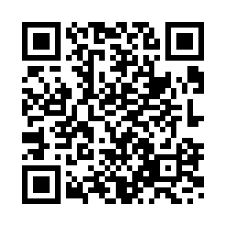

# ❤️ Support Development

If Telegram Web Proxy Manager has been useful to you, you can support its continued development. Contributions are voluntary; the project and all its features remain free and open source.

## Cryptocurrency

Choose a cryptocurrency and **match the network exactly**. Copy the address or scan its QR code in your wallet. The QR codes contain only the corresponding public receiving addresses.

<a id="usdt-tron"></a>
### USDT · Tron (TRC20)

**Asset:** Tether USD (USDT)  
**Network:** Tron (TRC20)

```text
TMQM99YVdfzN7sWn88ee57sTwVAk2DtUbt
```


<a id="usdt-solana"></a>
### USDT · Solana (SPL)

**Asset:** Tether USD (USDT)  
**Network:** Solana (SPL)

```text
HcxHutJjEqjobUy6PdGHMGd6ov7AbzFkarJHBp5RcN9Z
```



<a id="bitcoin"></a>
### Bitcoin (BTC)

**Asset:** Bitcoin (BTC)  
**Network:** Bitcoin (native SegWit)

```text
bc1qdxahy3jr4xquh583wde9fe8slaulula9qz3l6g
```


> **Important:** Send only the specified asset on the specified network. In particular, USDT on Tron and USDT on Solana are different blockchain networks. Check the full address in your wallet before sending. Blockchain transfers are generally irreversible.

---

# ❤️ Поддержать разработку

Если Telegram Web Proxy Manager оказался полезен, вы можете добровольно поддержать его дальнейшее развитие. Проект и все его возможности остаются бесплатными и открытыми.

## Криптовалюта

**Адреса кошельков и QR-коды приведены выше**, в разделе [Cryptocurrency](#cryptocurrency). Нажмите на нужную валюту, чтобы перейти к её реквизитам:

- [USDT в сети Tron (TRC20)](#usdt-tron)
- [USDT в сети Solana (SPL)](#usdt-solana)
- [Bitcoin (BTC)](#bitcoin)

Вы можете скопировать адрес из блока с кодом или отсканировать QR-код кошельком.

**Важно:** при отправке USDT обязательно выбирайте **ту же сеть**, которая указана рядом с адресом. Tron (TRC20) и Solana (SPL) несовместимы между собой. Перед подтверждением перевода проверьте полный адрес получателя. Криптовалютные переводы, как правило, необратимы.
